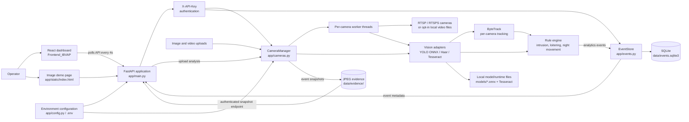
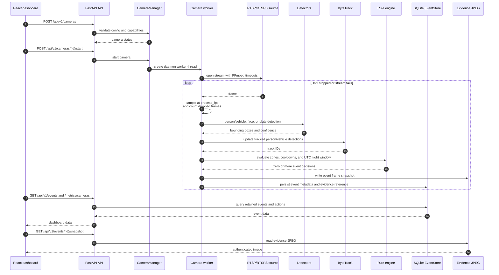
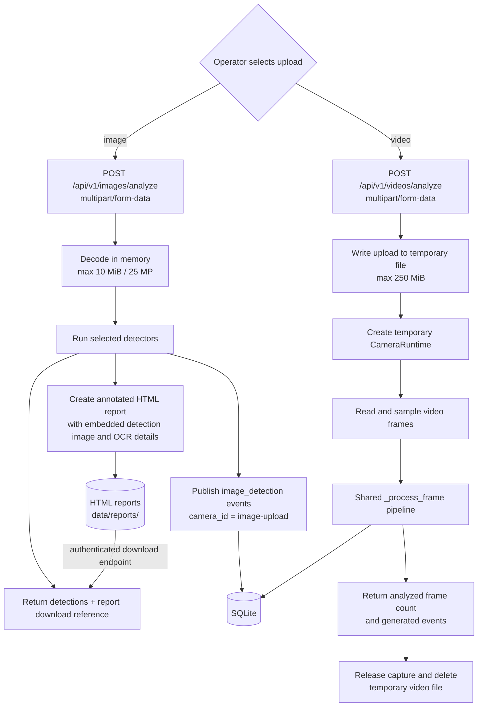
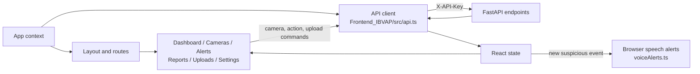
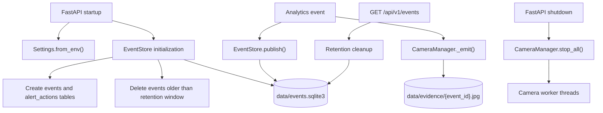
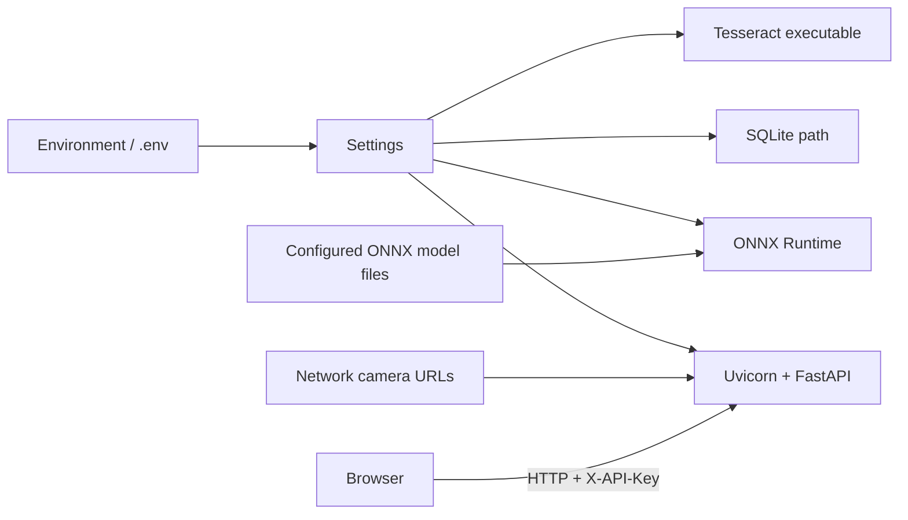

# IBVAP Architecture

This document describes the current runtime architecture of the IBVAP AI Video
Analytics Service. The diagrams are intentionally based on the implementation
in this repository, not on a future production design.

## 1. System overview

### Main responsibilities

| Area | Responsibility | Implementation |
| --- | --- | --- |
| Web/API boundary | Serves health/readiness, camera management, analysis, event, metrics, and snapshot endpoints | [`app/main.py`](./app/main.py) |
| Camera orchestration | Keeps camera configuration in memory and owns one worker thread per active camera | [`app/cameras.py`](./app/cameras.py) |
| Detection | Runs local ONNX object/plate detection, Haar face detection, and local OCR | [`app/vision.py`](./app/vision.py) |
| Tracking | Assigns stable IDs to person/vehicle detections for each camera | [`app/tracking.py`](./app/tracking.py) |
| Rules | Converts tracked detections into intrusion, loitering, and night-movement decisions | [`app/rules.py`](./app/rules.py), [`app/cameras.py`](./app/cameras.py) |
| Persistence | Stores event JSON and operator alert actions in SQLite; removes expired events | [`app/events.py`](./app/events.py) |
| Dashboard | Presents camera, alert, report, upload, and settings views; polls the API | [`Frontend_IBVAP/src/App.tsx`](./Frontend_IBVAP/src/App.tsx), [`Frontend_IBVAP/src/api.ts`](./Frontend_IBVAP/src/api.ts) |

## 2. Live camera flow

Each registered camera has its own worker thread. Camera configuration and
worker state are in memory, so cameras must be registered again after a service
restart.

### Event decision details

1. **Person/vehicle analytics** use the configured raw-output YOLOv8 ONNX
   model, class filtering, and non-maximum suppression.
2. **Tracking** uses ByteTrack independently for each camera worker.
3. **Virtual-fence intrusion** is emitted when a tracked detection enters a
   restricted polygon.
4. **Loitering** is emitted after a tracked detection remains in a zone for
   the configured duration.
5. **Night movement** is emitted for a tracked detection inside the configured
   UTC-hour window.
6. **Face detection** uses OpenCV Haar cascades and is not identity matching.
7. **ANPR** detects a plate with the plate YOLO model, then uses Tesseract OCR.
8. Event cooldown state prevents repeated events for the same event/track/key.

## 3. Image and video upload flows

Uploads are temporary analysis inputs. The uploaded bytes are not retained
after processing. Image analysis publishes `image_detection` events; video
analysis creates a temporary camera runtime so it can reuse the live pipeline.

Image and video reports include detected vehicle plate text and OCR confidence.
When no accepted plate reading is available, the report explicitly states
`Vehicle number not captured`. CSV alert exports expose vehicle number and OCR
confidence as dedicated columns. Reports embed annotated image results and
available video event snapshots. The vehicle-registry adapter is disabled until
an authorized API is configured; owner details are never inferred from OCR.

## 4. Dashboard request flow

The dashboard does not receive a push stream. After the token is configured,
[`App.tsx`](./Frontend_IBVAP/src/App.tsx) refreshes readiness, cameras, events,
and alert actions every four seconds.

The production-style dashboard is served at `/ui` when
`Frontend_IBVAP/dist/index.html` exists. The lightweight image-analysis
showcase is served at `/`. During frontend development, Vite serves the React
application separately.

## 5. Storage and lifecycle

- Event rows and alert actions are durable in SQLite.
- Camera registrations, credentials, detector instances, trackers, and rule
  state are process-local.
- Evidence JPEGs are stored beside the configured database path in an
  `evidence` directory.
- Plate-read events store an annotated full-frame evidence JPEG and a separate
  cropped plate JPEG; image and video HTML reports embed the detected plate
  crop beside the OCR text and confidence.
- The default event retention is 30 days and is configurable with
  `IBVAP_EVENT_RETENTION_DAYS`.
- No video frames or uploaded source videos are retained as part of normal
  processing.

## 6. Configuration and deployment boundary

The service is designed to run locally or on-premises. It does not call an
external AI provider. The API token is a service secret and must be configured
before `/api/v1` operations are available. See [`README.md`](./README.md) and
[`.env.example`](./.env.example) for setup and configuration details.

## 7. Important boundaries and limitations

- **Authentication:** `/api/v1/*` requires `X-API-Key`; `/health`, `/ready`,
  `/`, and `/docs` are outside that router-level dependency.
- **Source types:** RTSP/RTSPS are accepted by default. Local video files
  require `IBVAP_ALLOW_FILE_SOURCES=true`.
- **Inference:** models are loaded from local paths and are cached by
  `CameraManager`; model licenses and output compatibility must be verified
  before deployment.
- **Identity:** the service has no face recognition, biometric matching,
  watchlist, or identity lookup.
- **Delivery:** event consumption is polling-based. There is no websocket,
  message queue, command-center connector, or push notification integration.
- **Scaling:** camera workers and state live inside one process. Horizontal
  scaling would require an explicit ownership and shared-state design.
- **Evidence:** snapshots are evidence images, not a video archive. Protect
  plate text, event records, and snapshot access according to deployment
  policy.
